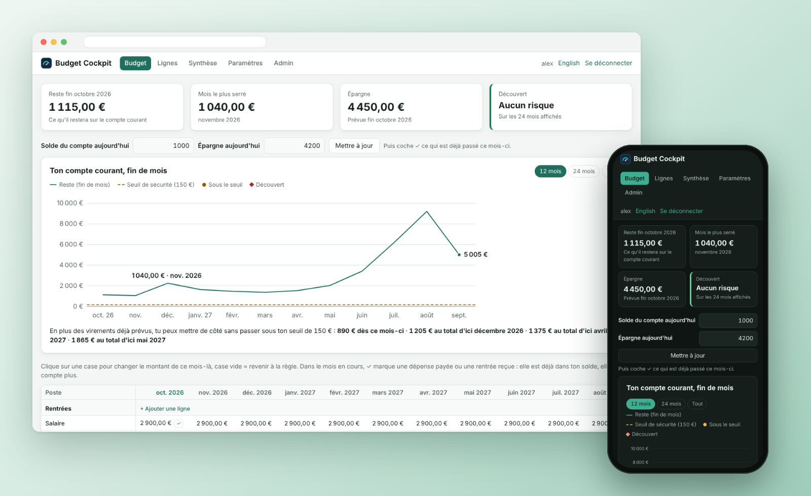
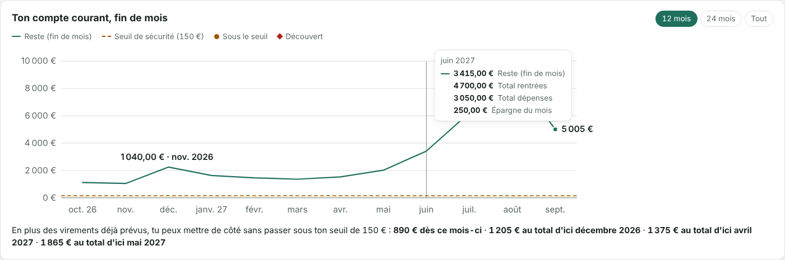
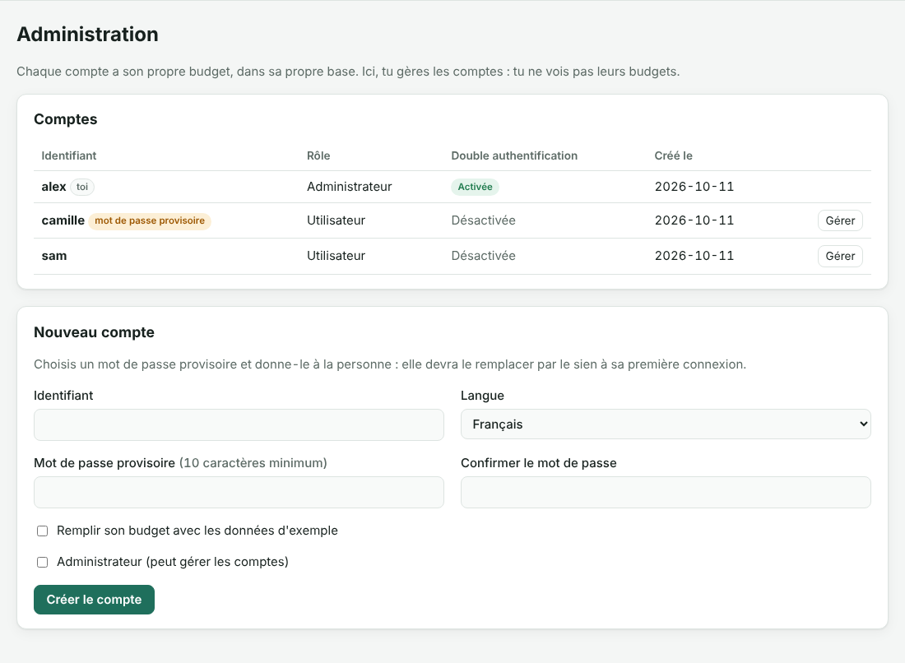
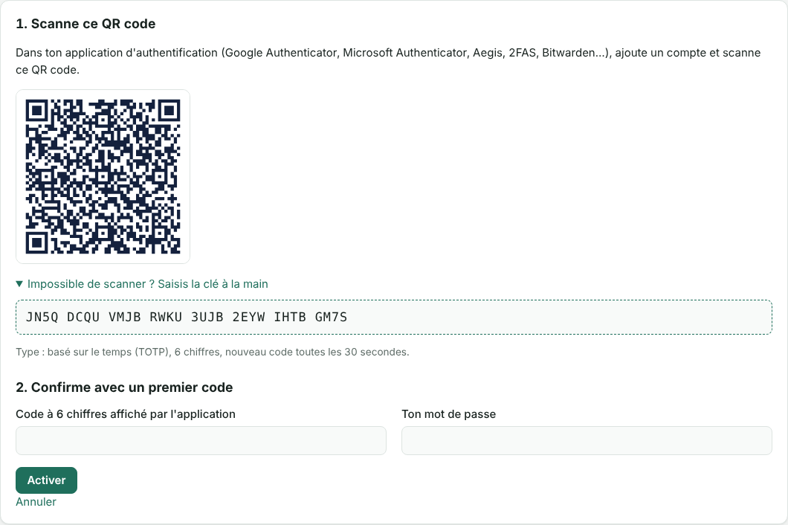
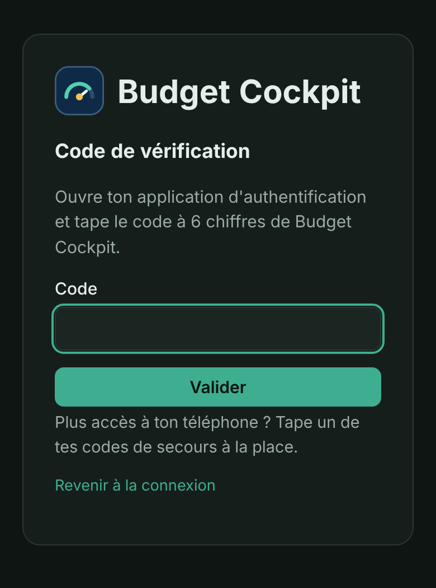

<div align="center">

# 📈 Budget Cockpit

### Sache chaque mois ce qu'il te restera sur ton compte

**Prévision mois par mois · Alerte de découvert · Courbes · Plusieurs comptes · Double authentification · Home Assistant**

🇬🇧 [Read in English](README.md)

<br>



<sub>Les captures montrent un foyer fictif de démonstration : tous les chiffres sont des exemples et ne correspondent pas à la situation de l'auteur.</sub>

<br><br>

**Auto-hébergé · Local d'abord · Bilingue (FR / EN) · Open source pour un usage non commercial**

</div>

---

## 🚀 En bref

<table>
<tr>
<td width="33%" valign="top"><b>🔮 Une prévision, pas un historique</b><br>Ce qu'il restera sur ton compte à la fin de chaque mois, jusqu'à dix ans à l'avance.</td>
<td width="33%" valign="top"><b>🚨 Alerte de découvert</b><br>Un seuil de sécurité, le mois le plus serré, et ce qu'il manque pour rester au-dessus.</td>
<td width="33%" valign="top"><b>📈 Des courbes utiles</b><br>Ton compte mois par mois, ton épargne, les mois qui te coûtent, l'année d'une maison louée.</td>
</tr>
<tr>
<td valign="top"><b>👥 Un budget chacun</b><br>Plusieurs comptes, chacun avec sa propre base. L'administrateur ne voit jamais le budget des autres.</td>
<td valign="top"><b>🔐 Double authentification</b><br>Un code d'application d'authentification après le mot de passe, et des codes de secours à usage unique.</td>
<td valign="top"><b>🏠 Home Assistant</b><br>Une API en lecture seule : le reste en fin de mois et les alertes sur ton tableau de bord.</td>
</tr>
</table>

---

## ✨ Ton budget, quelques années à l'avance

La plupart des outils de budget regardent en arrière : ils classent ce que tu as déjà dépensé.

Budget Cockpit regarde devant. Tu décris une seule fois tes rentrées et tes dépenses — salaire, loyer, crédit, location saisonnière, impôt annuel — et Budget Cockpit calcule, mois après mois, **ce qu'il restera sur ton compte courant**. Il te prévient avant le découvert, pas après.

Il est né d'un tableur qu'il fallait copier-coller tous les mois. Budget Cockpit le remplace : plus de colonnes à recopier, plus de formules cassées.

---

## 🧮 Une règle par ligne, puis plus rien à recopier

<table>
<tr>
<td width="50%" valign="top">

### 📋 Des lignes avec des règles


Chaque ligne a une règle, et les mois se remplissent tout seuls :

- **Tous les mois** — loyer, crédit, abonnements
- **Une fois par an** — taxe foncière, prime
- **Un montant différent selon le mois** — location saisonnière, électricité
- **Saisie manuelle** — astreinte, rentrée exceptionnelle
- **Montant annuel par année** — provisions d'impôt, mises de côté par douzièmes

Mois de début et de fin facultatifs, et des groupes pour suivre à part une maison louée.

</td>
<td width="50%" valign="top">

### ✏️ Les exceptions en un clic


Un mois est différent ? Clique sur sa case et tape le montant : elle est surlignée. Laisse-la vide pour revenir à la règle.

Dans le mois en cours, coche **✓** quand une dépense est payée ou une rentrée reçue : elle est déjà dans ton solde, elle ne compte plus.

</td>
</tr>
</table>

---

## 🚨 Ne plus jamais être à découvert

- **Reste (fin de mois)** pour chaque mois, à partir de ton vrai solde du jour
- **Seuil de sécurité** : *Attention* sous le montant que tu choisis, *Découvert* sous zéro
- **Mois le plus serré** et **première alerte** affichés en haut de la page
- **Clôturer le mois** en un clic : le mois passé disparaît et ton vrai solde devient le nouveau point de départ

<table>
<tr>
<td width="72%" valign="top"></td>
<td width="28%" valign="top"></td>
</tr>
<tr>
<td align="center"><b>Totaux, reste et alertes</b></td>
<td align="center"><b>Sur téléphone, en mode sombre</b></td>
</tr>
</table>

---

## 📈 Des courbes qui répondent à une question



- **Ton compte courant, fin de mois** : quand tu passes sous ton seuil ou à découvert, et jusqu'où tu descends
- **Ta marge d'épargne** : combien tu peux encore mettre de côté, et d'ici quand, sans passer sous le seuil — ou combien il te manque, et pour quand
- Dans la synthèse : **ce que chaque mois ajoute ou retire à ton compte**, **ton épargne prévue** et le **résultat de chaque groupe** (une maison louée, par exemple) avec son cumul de l'année

Survole ou touche un mois pour le détail. Les courbes sont dessinées par le serveur : rien n'est chargé depuis Internet.

---

## 📊 Toute l'année d'un coup d'œil


La synthèse s'ouvre sur trois courbes — ce que chaque mois ajoute ou retire à ton compte, ton épargne prévue, et l'année de chaque groupe (une maison louée, par exemple) — puis le tableau année par année : rentrées, dépenses, épargne prévue et ta **capacité d'épargne réelle**, par an et par mois.

---

## 👥 Un serveur, un budget chacun

Budget Cockpit peut servir à tout le foyer, ou à quelques proches : chaque compte a **son propre budget, dans sa propre base**.

- Le premier compte est administrateur. Il crée les autres avec un mot de passe provisoire, que chacun remplace par le sien à sa première connexion
- L'administrateur gère les comptes (mot de passe, double authentification, rôles, suppression), mais ne voit jamais le budget des autres
- Chacun a ses propres paramètres, sauvegardes et clés Home Assistant



---

## 🏠 Pensé pour Home Assistant

Budget Cockpit tourne à côté de Home Assistant et expose une **API en lecture seule, protégée par une clé**. En quelques lignes de YAML, Home Assistant récupère :

- le reste prévu en fin de mois,
- le mois le plus serré,
- l'alerte de découvert — et peut t'envoyer une notification quand elle change.

Voir [docs/user/HOME_ASSISTANT.fr.md](docs/user/HOME_ASSISTANT.fr.md).

---

## 📦 Installation

```yaml
# docker-compose.yml
services:
  budget-cockpit:
    image: ghcr.io/vinzgithub/budget-cockpit:latest
    restart: unless-stopped
    ports: ["8080:8080"]
    volumes: ["budget-cockpit-data:/data"]
volumes:
  budget-cockpit-data:
```

```bash
docker compose up -d
```

Ouvre `http://<ton-serveur>:8080`, crée le compte administrateur, puis pars des données d'exemple ou saisis tes propres lignes. Les autres comptes se créent dans **Admin**.

Guide complet, avec un conteneur LXC Proxmox et un reverse proxy : [docs/user/INSTALLATION.fr.md](docs/user/INSTALLATION.fr.md).

> Budget Cockpit contient tes données financières. Garde-le sur ton réseau local ou derrière un VPN, et sauvegarde le volume `/data`.

---

## 🔒 Sécurisé par défaut

- Pas de mot de passe par défaut : la première visite crée le compte administrateur
- Une base SQLite par compte : les budgets restent séparés, et les administrateurs ne peuvent pas les ouvrir
- Mots de passe hachés avec scrypt, limitation des tentatives de connexion, protection CSRF sur chaque formulaire
- Double authentification en option : un code d'application d'authentification (TOTP) après le mot de passe, avec des codes de secours à usage unique
- Content-Security-Policy stricte, aucun script, police ou traceur externe — Budget Cockpit n'appelle jamais Internet
- Clés d'API affichées une seule fois et conservées uniquement sous forme d'empreinte
- Utilisateur non root, conteneur en lecture seule

<table>
<tr>
<td width="66%" valign="top"></td>
<td width="34%" valign="top"></td>
</tr>
<tr>
<td align="center"><b>La double authentification en un scan</b></td>
<td align="center"><b>Le code demandé après le mot de passe</b></td>
</tr>
</table>

Détails et signalement : [SECURITY.md](SECURITY.md).

---

## 💾 Tes données

Tout tient dans des fichiers SQLite dans `/data` : un pour les comptes, et un par personne pour son budget. La page **Paramètres** exporte et importe le budget de chacun en JSON. Rien n'est jamais envoyé ailleurs.

---

## 🛡️ Licence et droits d'auteur

**Copyright © 2026 Vincent Fournet.**

Le code source est publié sous la **PolyForm Noncommercial License 1.0.0**.

Voir :

- [LICENSE](LICENSE)
- [NOTICE](NOTICE)
- [Licence commerciale](COMMERCIAL-LICENSE.md)

### Usage commercial

La licence publique **n'accorde pas** de droit d'usage commercial.

Tout usage commercial — revente, redistribution payante, hébergement payant, intégration dans un produit ou un service commercial — nécessite une licence écrite distincte de Vincent Fournet.

**L'accès au code source public ne vaut pas licence commerciale.**

---

## 🤖 Développé avec l'aide de l'IA

Budget Cockpit est développé avec l'assistance de Claude, l'assistant IA d'Anthropic, qui contribue à la conception, au code, aux tests et à la documentation. L'auteur décide de ce qui entre dans le projet et publie chaque version.

---

## ℹ️ Avertissement

Budget Cockpit est un outil de prévision, pas un conseil financier ou fiscal. Une prévision ne vaut que par les montants saisis.

Les chiffres des captures et de la documentation viennent du foyer fictif de démonstration fourni avec l'appli. Ce sont des exemples : ils ne reflètent pas la situation de l'auteur.

Home Assistant et les autres noms de produits ou de sociétés cités restent la propriété de leurs détenteurs.

---

<div align="center">

### 📈 Budget Cockpit

**Ce qu'il reste, mois après mois.**

Copyright © 2026 Vincent Fournet

</div>
