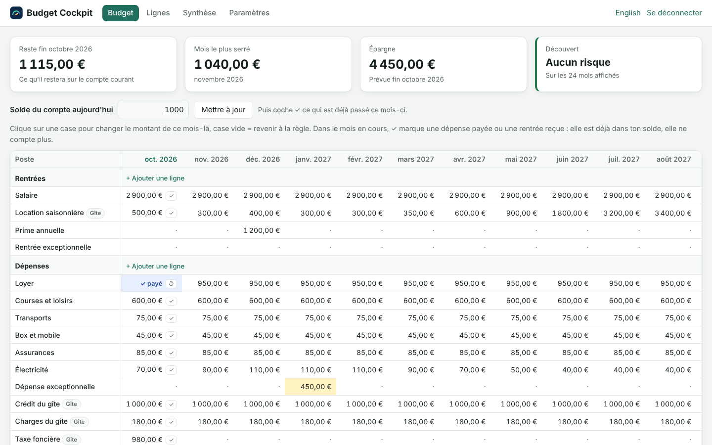
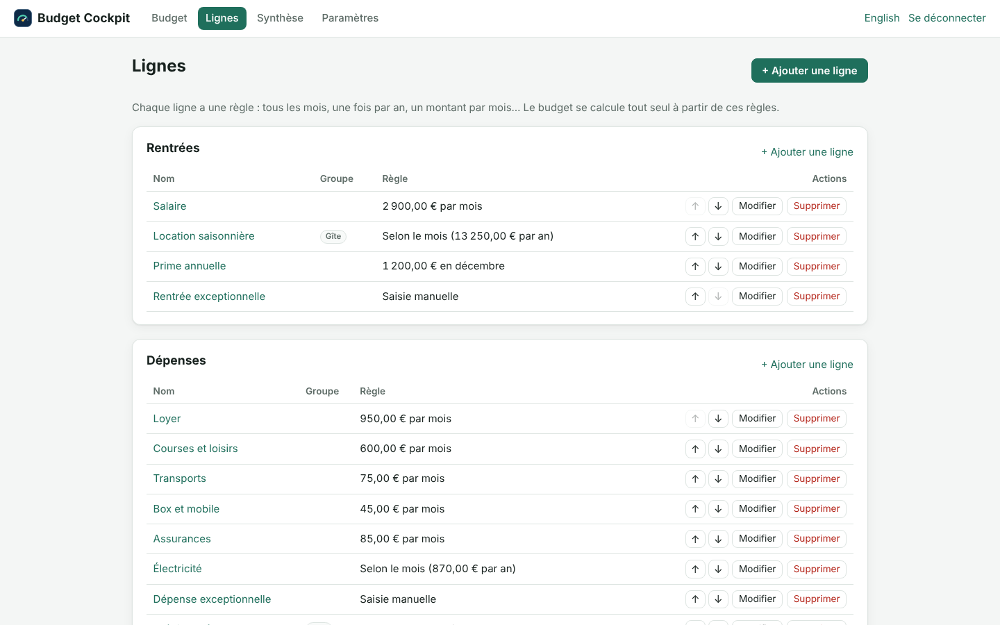
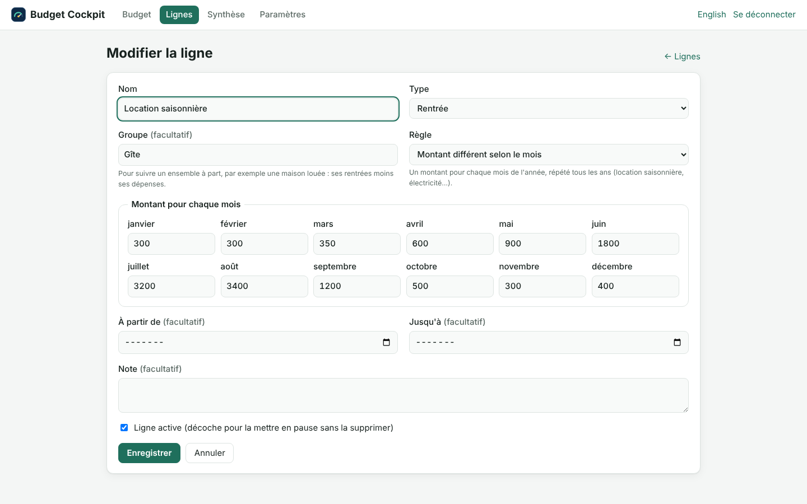
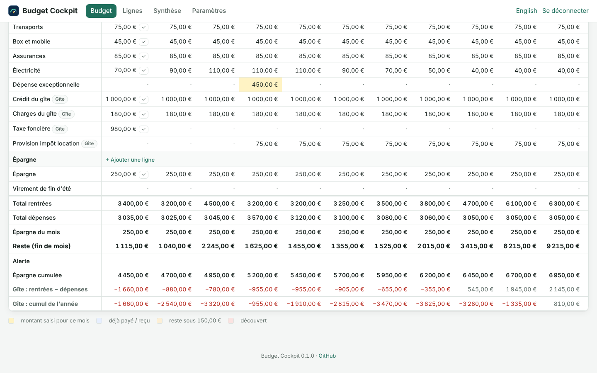
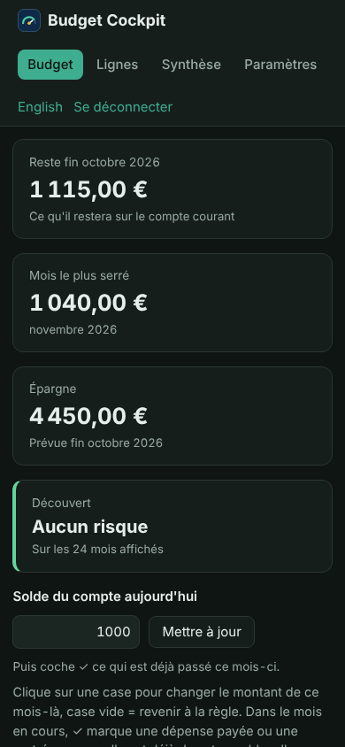
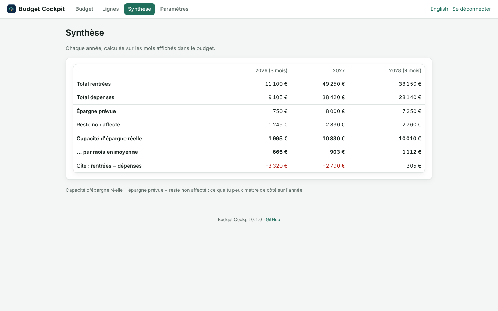

<div align="center">

# 📈 Budget Cockpit

### Sache chaque mois ce qu'il te restera sur ton compte

**Prévision mois par mois · Alerte de découvert · Revenus saisonniers · Provisions d'impôt · Home Assistant**

🇬🇧 [Read in English](README.md)

<br>



<br><br>

**Auto-hébergé · Local d'abord · Bilingue (FR / EN) · Open source pour un usage non commercial**

</div>

---

## ✨ Ton budget, quelques années à l'avance

La plupart des outils de budget regardent en arrière : ils classent ce que tu as déjà dépensé.

Budget Cockpit regarde devant. Tu décris une seule fois tes rentrées et tes dépenses — salaire, loyer, crédit, location saisonnière, impôt annuel — et Budget Cockpit calcule, mois après mois, **ce qu'il restera sur ton compte courant**. Il te prévient avant le découvert, pas après.

Il est né d'un tableur qu'il fallait copier-coller tous les mois. Budget Cockpit le remplace : plus de colonnes à recopier, plus de formules cassées.

---

## 🧮 Une règle par ligne, puis plus rien à recopier

<table>
<tr>
<td width="50%" valign="top">

### 📋 Des lignes avec des règles



Chaque ligne a une règle, et les mois se remplissent tout seuls :

- **Tous les mois** — loyer, crédit, abonnements
- **Une fois par an** — taxe foncière, prime
- **Un montant différent selon le mois** — location saisonnière, électricité
- **Saisie manuelle** — astreinte, rentrée exceptionnelle
- **Montant annuel par année** — provisions d'impôt, mises de côté par douzièmes

Mois de début et de fin facultatifs, et des groupes pour suivre à part une maison louée.

</td>
<td width="50%" valign="top">

### ✏️ Les exceptions en un clic



Un mois est différent ? Clique sur sa case et tape le montant : elle est surlignée. Laisse-la vide pour revenir à la règle.

Dans le mois en cours, coche **✓** quand une dépense est payée ou une rentrée reçue : elle est déjà dans ton solde, elle ne compte plus.

</td>
</tr>
</table>

---

## 🚨 Ne plus jamais être à découvert

- **Reste (fin de mois)** pour chaque mois, à partir de ton vrai solde du jour
- **Seuil de sécurité** : *Attention* sous le montant que tu choisis, *Découvert* sous zéro
- **Mois le plus serré** et **première alerte** affichés en haut de la page
- **Clôturer le mois** en un clic : le mois passé disparaît et ton vrai solde devient le nouveau point de départ

<table>
<tr>
<td width="72%" valign="top"></td>
<td width="28%" valign="top"></td>
</tr>
<tr>
<td align="center"><b>Totaux, reste et alertes</b></td>
<td align="center"><b>Sur téléphone, en mode sombre</b></td>
</tr>
</table>

---

## 📊 Toute l'année d'un coup d'œil



La synthèse donne, par année et par mois, les rentrées, les dépenses, l'épargne prévue et ta **capacité d'épargne réelle** — ainsi que le résultat de chaque groupe, par exemple une maison louée.

---

## 🏠 Pensé pour Home Assistant

Budget Cockpit tourne à côté de Home Assistant et expose une **API en lecture seule, protégée par une clé**. En quelques lignes de YAML, Home Assistant récupère :

- le reste prévu en fin de mois,
- le mois le plus serré,
- l'alerte de découvert — et peut t'envoyer une notification quand elle change.

Voir [docs/user/HOME_ASSISTANT.fr.md](docs/user/HOME_ASSISTANT.fr.md).

---

## 📦 Installation

```yaml
# docker-compose.yml
services:
  budget-cockpit:
    image: ghcr.io/vinzgithub/budget-cockpit:latest
    restart: unless-stopped
    ports: ["8080:8080"]
    volumes: ["budget-cockpit-data:/data"]
volumes:
  budget-cockpit-data:
```

```bash
docker compose up -d
```

Ouvre `http://<ton-serveur>:8080`, crée ton compte, puis pars des données d'exemple ou saisis tes propres lignes.

Guide complet, avec un conteneur LXC Proxmox et un reverse proxy : [docs/user/INSTALLATION.fr.md](docs/user/INSTALLATION.fr.md).

> Budget Cockpit contient tes données financières. Garde-le sur ton réseau local ou derrière un VPN, et sauvegarde le volume `/data`.

---

## 🔒 Sécurisé par défaut

- Pas de mot de passe par défaut : la première visite crée le seul compte
- Mots de passe hachés avec scrypt, limitation des tentatives de connexion, protection CSRF sur chaque formulaire
- Content-Security-Policy stricte, aucun script, police ou traceur externe — Budget Cockpit n'appelle jamais Internet
- Clés d'API affichées une seule fois et conservées uniquement sous forme d'empreinte
- Utilisateur non root, conteneur en lecture seule

Détails et signalement : [SECURITY.md](SECURITY.md).

---

## 💾 Tes données

Tout tient dans un seul fichier SQLite dans `/data`. La page **Paramètres** exporte et importe une sauvegarde JSON. Rien n'est jamais envoyé ailleurs.

---

## 🛡️ Licence et droits d'auteur

**Copyright © 2026 Vincent Fournet.**

Le code source est publié sous la **PolyForm Noncommercial License 1.0.0**.

Voir :

- [LICENSE](LICENSE)
- [NOTICE](NOTICE)
- [Licence commerciale](COMMERCIAL-LICENSE.md)

### Usage commercial

La licence publique **n'accorde pas** de droit d'usage commercial.

Tout usage commercial — revente, redistribution payante, hébergement payant, intégration dans un produit ou un service commercial — nécessite une licence écrite distincte de Vincent Fournet.

**L'accès au code source public ne vaut pas licence commerciale.**

---

## ℹ️ Avertissement

Budget Cockpit est un outil de prévision, pas un conseil financier ou fiscal. Une prévision ne vaut que par les montants saisis.

Home Assistant et les autres noms de produits ou de sociétés cités restent la propriété de leurs détenteurs.

---

<div align="center">

### 📈 Budget Cockpit

**Ce qu'il reste, mois après mois.**

Copyright © 2026 Vincent Fournet

</div>
