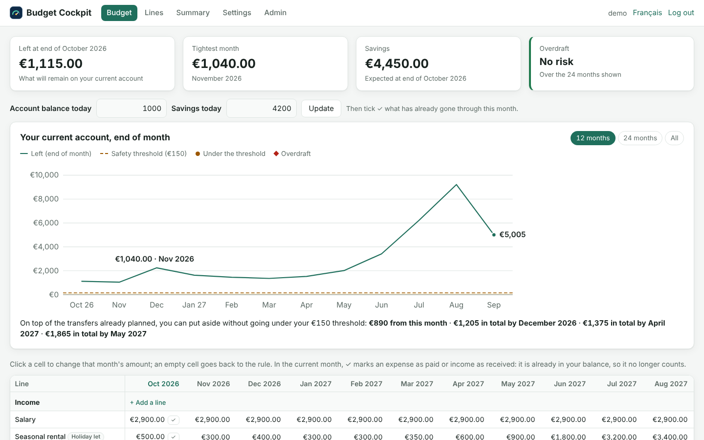
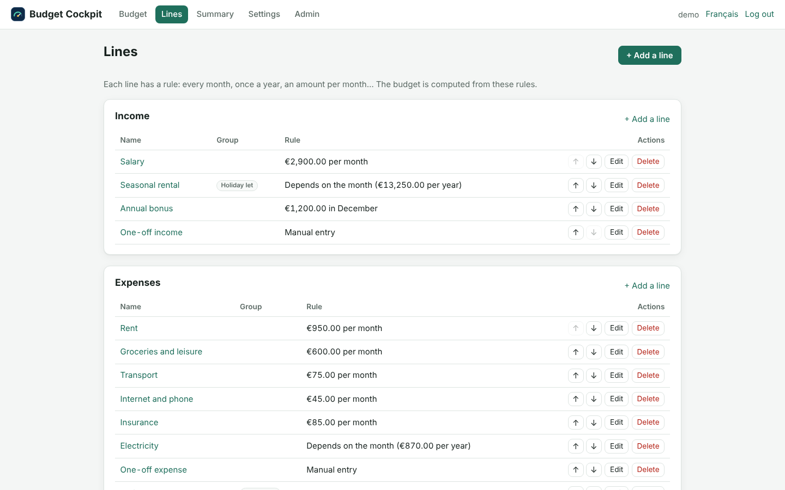
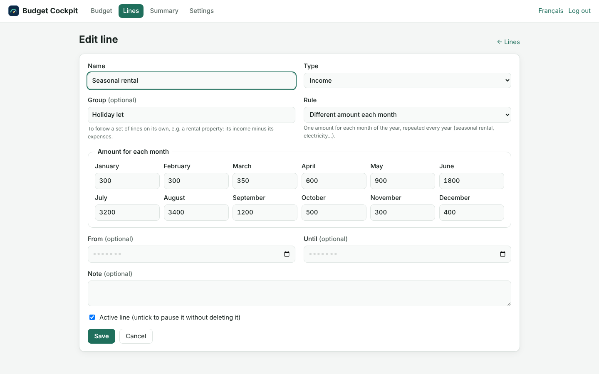
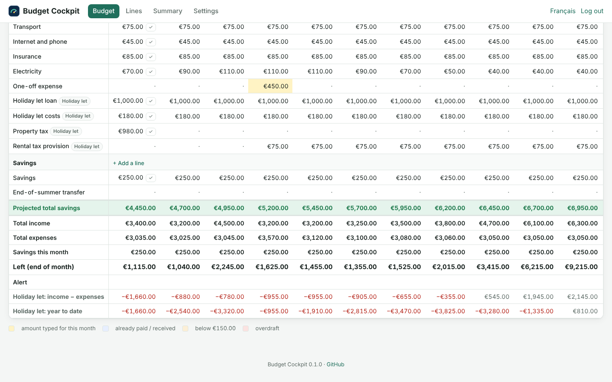
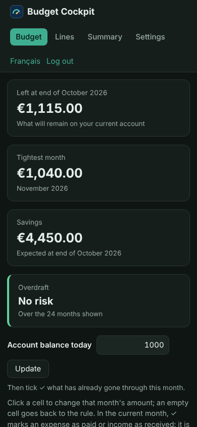
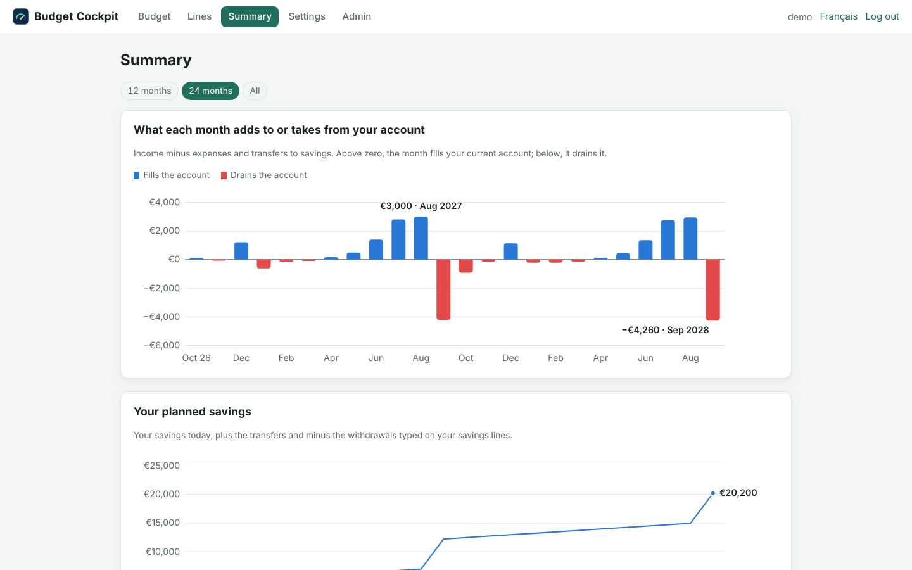

<div align="center">

# 📈 Budget Cockpit

### Know what will be left on your account at the end of every month

**Month-by-month forecast · Overdraft alerts · Seasonal income · Tax provisions · Home Assistant**

🇫🇷 [Lire en français](README.fr.md)

<br>



<sub>The screenshots show a fictional demo household: every figure is an example and none of them are the author's own finances.</sub>

<br><br>

**Self-hosted · Local-first · Bilingual (FR / EN) · Open source for non-commercial use**

</div>

---

## ✨ Your budget, a few years ahead

Most budgeting tools look backwards: they categorise what you already spent.

Budget Cockpit looks forward. You describe your income and expenses once — salary, rent, loan, a seasonal rental, a yearly tax — and Budget Cockpit projects, month after month, **what will be left on your current account**. It warns you before an overdraft, not after.

It started as a spreadsheet that had to be copied and pasted every month. Budget Cockpit replaces that spreadsheet: no more copying columns, no more broken formulas.

---

## 🧮 One rule per line, then nothing to copy

<table>
<tr>
<td width="50%" valign="top">

### 📋 Lines with rules



Every line has a rule, and the months fill themselves:

- **Every month** — rent, loan, subscriptions
- **Once a year** — property tax, bonus
- **Different amount each month** — seasonal rental, electricity
- **Manual entry** — on-call pay, one-off income
- **Annual amount per year** — tax provisions, set aside in twelfths

Optional start and end months, and groups to follow a rental property on its own.

</td>
<td width="50%" valign="top">

### ✏️ Exceptions in one click



A month is different? Click its cell and type the amount; it is highlighted. Leave it empty to go back to the rule.

During the current month, tick **✓** when an expense is paid or income received: it is already in your balance, so it stops counting.

</td>
</tr>
</table>

---

## 🚨 Never be overdrawn again

- **Left (end of month)** for every month, from your real balance today
- **Safety threshold**: a *Warning* below your chosen amount, an *Overdraft* alert below zero
- **Tightest month** and **first alert** shown at the top of the page
- **Close the month** in one click: the past month disappears and your real balance becomes the new starting point

<table>
<tr>
<td width="72%" valign="top"></td>
<td width="28%" valign="top"></td>
</tr>
<tr>
<td align="center"><b>Totals, balance and alerts</b></td>
<td align="center"><b>On a phone, in dark mode</b></td>
</tr>
</table>

---

## 📊 See the whole year



The yearly summary shows income, expenses, planned savings and your **real saving capacity** per year and per month — plus the net result of each group, for example a rental property.

---

## 👥 One server, one budget each

Budget Cockpit can serve the whole household, or a few relatives: each account has **its own budget, in its own database**.

- The first account is the administrator. It creates the others with a temporary password, which each person replaces with their own at first login
- The administrator manages accounts (password reset, two-factor authentication, roles, deletion) but never sees anyone else's budget
- Everyone has their own settings, backups and Home Assistant keys

---

## 🏠 Built for Home Assistant

Budget Cockpit runs on its own, next to Home Assistant, and exposes a **read-only API protected by a key**. In a few lines of YAML, Home Assistant gets:

- the forecast balance at the end of the month,
- the tightest month,
- the overdraft alert — and can notify your phone when it changes.

See [docs/user/HOME_ASSISTANT.md](docs/user/HOME_ASSISTANT.md).

---

## 📦 Installation

```yaml
# docker-compose.yml
services:
  budget-cockpit:
    image: ghcr.io/vinzgithub/budget-cockpit:latest
    restart: unless-stopped
    ports: ["8080:8080"]
    volumes: ["budget-cockpit-data:/data"]
volumes:
  budget-cockpit-data:
```

```bash
docker compose up -d
```

Open `http://<your-server>:8080`, create your account, and either start from sample data or enter your own lines.

Full guide, including a Proxmox LXC and a reverse proxy: [docs/user/INSTALLATION.md](docs/user/INSTALLATION.md).

> Budget Cockpit holds your financial data. Keep it on your local network or behind a VPN, and back up the `/data` volume.

---

## 🔒 Security by default

- No default password: the first visit creates the administrator account
- One SQLite database per account: budgets stay apart, and administrators cannot open them
- Passwords hashed with scrypt, login throttling, CSRF protection on every form
- Optional two-factor authentication: a code from an authenticator app (TOTP) after the password, with single-use recovery codes
- Strict Content-Security-Policy, no external scripts, fonts or trackers — Budget Cockpit never calls the Internet
- API keys shown once and stored only as a hash
- Runs as a non-root user in a read-only container

Details and reporting: [SECURITY.md](SECURITY.md).

---

## 💾 Your data

Everything lives in SQLite files in `/data`: one for the accounts, and one per person for their budget. The **Settings** page exports and imports each person's budget as JSON. Nothing is ever sent anywhere.

---

## 🛡️ License & copyright

**Copyright © 2026 Vincent Fournet.**

The source code is licensed under the **PolyForm Noncommercial License 1.0.0**.

See:

- [LICENSE](LICENSE)
- [NOTICE](NOTICE)
- [Commercial licensing](COMMERCIAL-LICENSE.md)

### Commercial use

The public license does **not** grant commercial-use rights.

Commercial use, resale, paid redistribution, paid hosting, inclusion in a commercial product or service, or other commercial exploitation requires a separate written license from Vincent Fournet.

**Access to the public source code does not grant a commercial license.**

---

## 🤖 Built with AI assistance

Budget Cockpit is developed with the assistance of Claude, Anthropic's AI assistant, which contributes to the design, code, tests and documentation. The author decides what goes into the project and publishes every release.

---

## ℹ️ Disclaimer

Budget Cockpit is a forecasting tool, not financial or tax advice. Forecasts are only as good as the amounts you enter.

The figures in the screenshots and in the documentation come from the fictional demo household shipped with the app. They are examples only and do not reflect the author's finances.

Home Assistant and other product or company names mentioned by this project remain the property of their respective owners.

---

<div align="center">

### 📈 Budget Cockpit

**What's left, month after month.**

Copyright © 2026 Vincent Fournet

</div>
